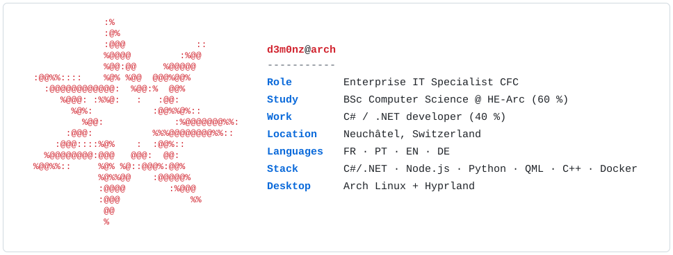
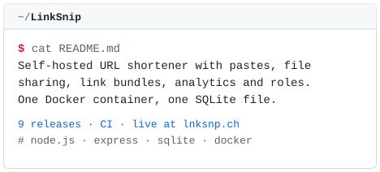
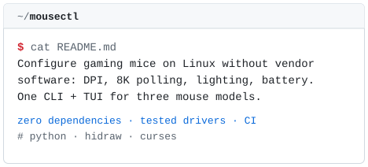
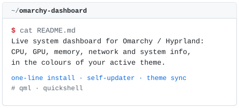
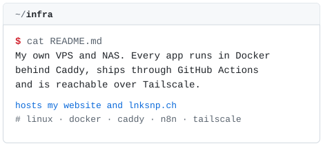
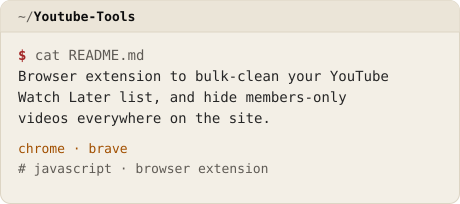
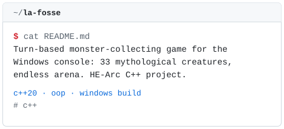

<picture>
  <source media="(prefers-color-scheme: dark)" srcset="assets/card-dark.svg">
  
</picture>

I'm an Enterprise IT Specialist CFC, now doing a BSc in Computer Science at HE-Arc (60 %) while working as a C#/.NET developer (40 %) on **SchemaSuite**, a WPF software suite for managing technical networks. That code is proprietary. What's here is what I build in my own time: tools for my Linux desktop, self-hosted web apps and the servers they run on.

LinkSnip runs in production: try it at **[lnksnp.ch](https://lnksnp.ch)**.

**[ivodantas.ch](https://ivodantas.ch)** (CV, background and contact) · **[LinkedIn](https://linkedin.ivodantas.ch)**

## Projects

<a href="https://github.com/D3m0nZOnFire/LinkSnip"><picture><source media="(prefers-color-scheme: dark)" srcset="assets/projects/LinkSnip-dark.svg"></picture></a><a href="https://github.com/D3m0nZOnFire/mousectl"><picture><source media="(prefers-color-scheme: dark)" srcset="assets/projects/mousectl-dark.svg"></picture></a><a href="https://github.com/D3m0nZOnFire/omarchy-dashboard"><picture><source media="(prefers-color-scheme: dark)" srcset="assets/projects/omarchy-dashboard-dark.svg"></picture></a><picture><source media="(prefers-color-scheme: dark)" srcset="assets/projects/infra-dark.svg"></picture><a href="https://github.com/D3m0nZOnFire/Youtube-Tools"><picture><source media="(prefers-color-scheme: dark)" srcset="assets/projects/Youtube-Tools-dark.svg"></picture></a><a href="https://github.com/D3m0nZOnFire/la-fosse"><picture><source media="(prefers-color-scheme: dark)" srcset="assets/projects/la-fosse-dark.svg"></picture></a>

